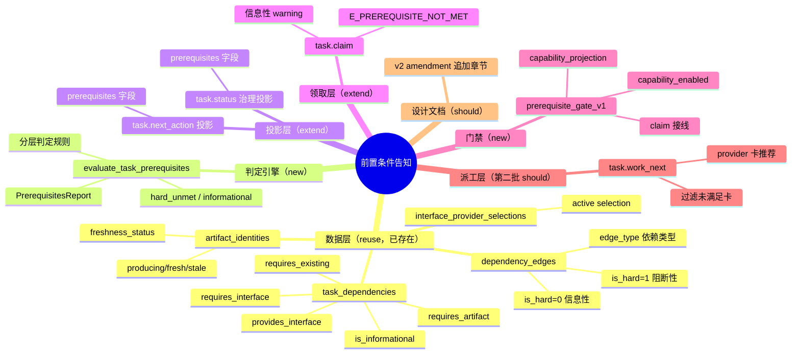

# 前置条件告知 — 领域概念图（R1）

## 概念关系

- `dependency_edges` 是 `task_dependencies` 的物化视图：声明写入时生成 provider→consumer 边，`is_hard` 由 `is_informational` 取反派生
- 判定引擎只读消费 `dependency_edges`（is_hard=1 得硬依赖清单）+ `tasks.lifecycle_status` + `artifact_identities.freshness_status` + `interface_provider_selections`
- 投影层与 claim 层共用同一判定引擎输出（同构保证，见 assumptions）
- capability 是 claim 写路径的启用开关：未启用 = 存量行为（不检查）；启用 = 硬依赖 fail-closed
