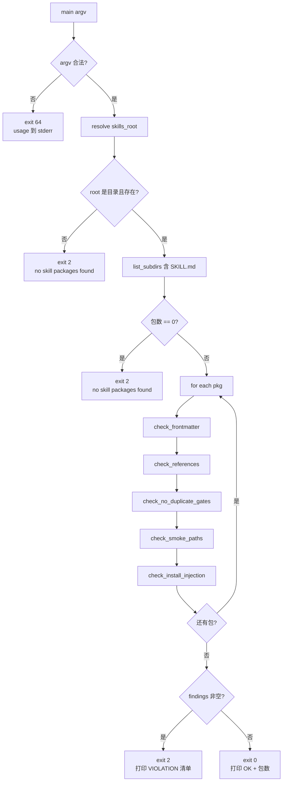
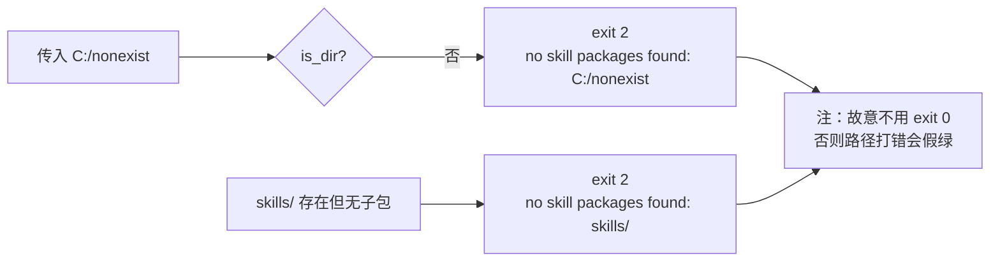
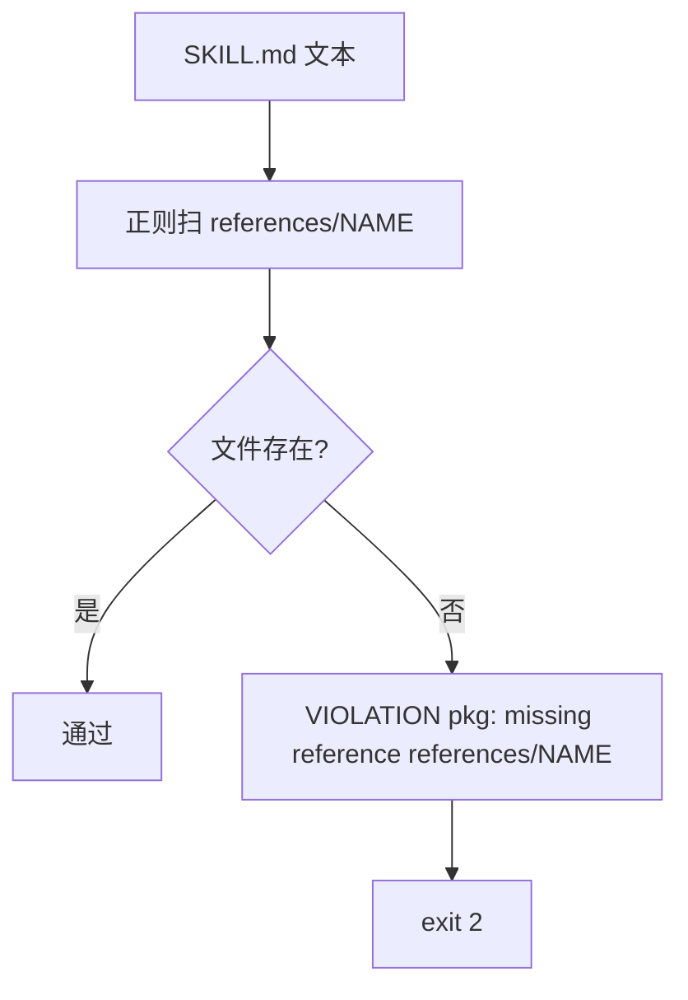
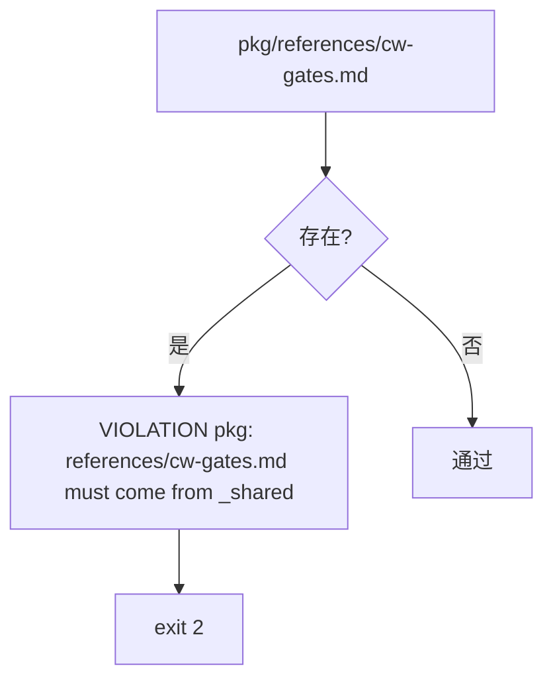
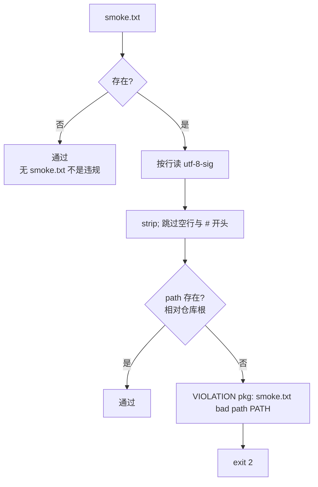

# flowchart · skillpkg-guard

> R1 产出。主链路 + **四条异常分支**（空目录 / 缺引用 / 违反单一源 / 坏路径）。

## 主流程



## 异常分支 1 · 空目录 / 路径打错



## 异常分支 2 · 引用断链（AC-03）



> 边界：正则只取 `references/<filename>` 形态，文件名限定 `[\w.\-]+`；不追进代码块内的示例路径（见 contracts.md C-02 的豁免规则）。

## 异常分支 3 · 违反单一源（AC-04）



## 异常分支 4 · 冒烟集坏路径（AC-05）



> 关键：**整行**做路径，不切 `#`。行内注释会被当成路径的一部分（历史真实故障，见 test-cw `references/smoke.txt` 的注释行修复）。因此 `#` 只允许出现在行首。

## 数据流

```
argv ──► parse_args ──► RepoRoot(derived from __file__ 上溯两级)
                          │
                          ├─► scan_packages(root) -> list[Pkg]
                          ├─► run_checks(pkg) -> list[Finding]
                          └─► format(findings, json?) -> stdout
                                              └─► exit_code(findings, parse_ok)
```

## 状态断言（设计期即固定）

| 断言 | 值 |
|---|---|
| 无中间写入 | 全程只读，无临时文件 |
| 幂等 | 同一输入两次运行，findings 与 exit code 完全一致 |
| 耗时 | 真实三包 < 1s |
| 网络 | 0 次 |
| 第三方依赖 | 0（仅 `argparse`/`json`/`os`/`re`/`sys`/`pathlib`） |
