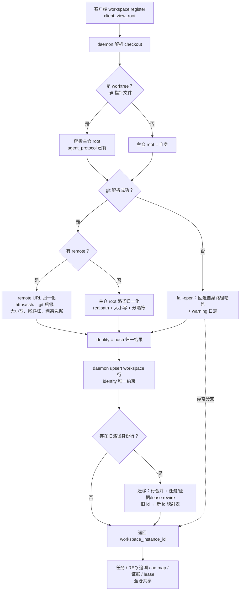
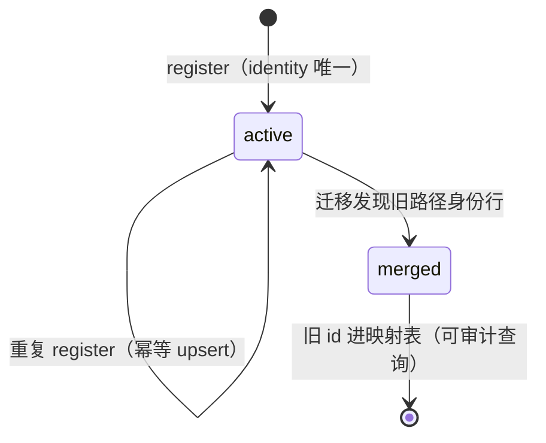

# flowchart · ws-identity 端到端数据流（含异常分支）

异常分支说明：

| 分支 | 触发 | 行为 |
|---|---|---|
| X1 fail-open | 非 git 目录 / 无 remote 且无主仓 / 悬空 worktree | 回退自身路径哈希 + warning，注册不阻塞 |
| 迁移分支 | upsert 时发现同 repo 旧路径身份行 | 行合并 + rewire + 映射表，可重跑幂等 |
| 并发注册 | 两客户端同时首次注册同 repo | identity 唯一约束 + upsert 裁决（R2 确认现有约束） |

状态机视角（workspace 行）：

