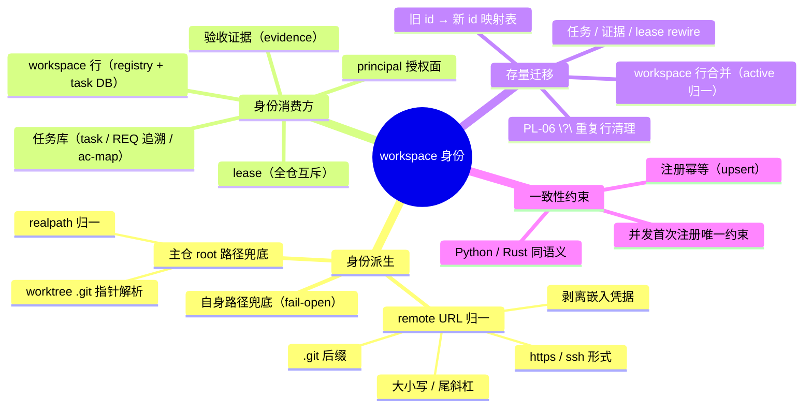

# mindmap · ws-identity 领域概念

概念要点：

- **身份派生三级**：remote → 主仓 root → 自身路径；前两级失败不阻塞（fail-open）。
- **checkout 只是执行位置**：worktree / clone 不再产生独立身份，任务与证据天然全仓共享。
- **迁移是行 rewire 不是数据合并**：任务、证据、lease 原样保留，只改 workspace_id 归属；旧 id 留映射表审计。